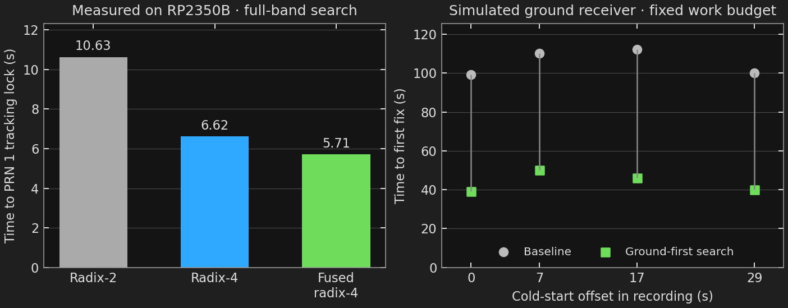
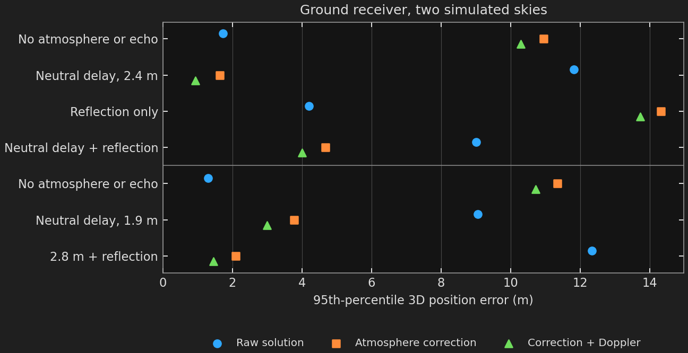

# Lock time and position accuracy

## Time from cold start

The native receiver reports status every 200 ms. A lock means a channel tracks the code and carrier. A cold position also needs usable broadcast clock and orbit data from at least four satellites with suitable geometry. GPS L1 C/A sends 50 navigation bits per second in 300-bit subframes. The receiver checks subframes 1–3 for parity and a consistent ephemeris issue. [GPS interface specification, section 20.3](https://archive.gps.gov/technical/icwg/IS-GPS-200N.pdf)

| Cold input and receiver | First reported channel lock | Four channels locked | First valid position |
| --- | ---: | ---: | ---: |
| 12 simulated LEO starts, native half-chip | 0.2–1.2 s | 1.8–2.4 s | 23.8–36.4 s |
| Independent static ground recording, native half-chip | 0.2 s | 1.2 s | 33.2 s |
| 550 km raw replay on the Pico, prefix tracker and USB pacing | 0.6 s | 7.0 s | 44.6 s |

All times in the table are elapsed **signal time**. The median first valid LEO position across the 12 starts was 31.8 s. In the Pico run four channels had decoded navigation data at 38.6 s. The host and Pico took 926.77 s of wall time to process the 45.404 s stream. [Receiver CSV measurements](measurements/doppler-position.json) · [Target replay](results.md#cold-replay-on-the-physical-rp2350b)

On the 150 MHz Pico, a cold search across ±70 kHz found a strong PRN 1 in **10.628 s** with the original FFT, **6.616 s** with radix-4, and **5.706 s** after combining the spectrum multiplication with the first FFT stage. All three ran the same 1,141 search steps with a real sample clock and DMA. Code phase and Doppler agreed with the input, and all three held lock for 20 consecutive epochs with zero lost blocks. These measurements isolate the FFT change. The repeated millisecond carries a constant navigation bit. [Pico measurements](measurements/pico-acquisition.json) · [Bench commands](../../firmware/README.md#cold-first-channel-timing)

The right panel uses independent ground I/Q and the same acquisition budget for both receivers. Starting at four different points in the navigation message, the revised ground search produced a first position in **39.2–50.2 s**. The previous receiver took **99.2–112.2 s**. [Ground and orbital trials](independent.md#cold-search-at-a-fixed-work-rate)

A separate host-paced run sent the original four-bit ground recording through the physical Pico. The baseline half-chip build returned its first position at 39.2 s of recording time, 608.0 s after playback started. All five observed positions used eight satellites. Their 95th-percentile 3D position and velocity errors were 0.82 m and 0.123 m/s. An assembled front end and antenna are needed to measure time from power-on to an outdoor fix. [Target measurements](measurements/pico-acquisition.json) · [Ground procedure](ground.md)

## Doppler-aided position at 5 Hz

Each valid fix has an Earth-fixed position from code and velocity from Doppler. The optional filter integrates the two most recent velocities over 200 ms, then moves the predicted position 1/40 of the way toward the current code position. It needs six stored coordinates and one sample timestamp. The first valid fix passes straight through. An invalid fix, capture gap, restart or missed solution interval resets the estimate. Clock, velocity, validity and the raw solver residuals retain their single-epoch meaning. Set `-DEPHEMERIS_DOPPLER_POSITION=ON` in either build. [Implementation](../../receiver/navigation.cpp) · [Independent calculation from status logs](../../tools/position_trial.py)

The time constant was fixed at a nominal eight seconds on the first 550 km case. On all twelve half-chip recordings, paired over 7,152 eligible fixes, per-run p95 3D position error fell from 2.31–4.16 m to 1.08–2.88 m. Applying the same causal calculation to the three complete scalar orbit logs gave 0.82–0.83 m p95. An independent 90 s orbital waveform replayed directly through both compiled half-chip receivers gave **0.829 m → 0.524 m**. Both produced their first fix at 33.2 s and returned 285 consecutive fixes. The independent static waveform gave **1.005 m → 0.968 m**. These numbers include startup. A persistent velocity bias can itself bias a smoothed position, so the general-purpose build keeps this option off for comparison. [Paired epochs, truth and binary hashes](measurements/doppler-position.json)

On the Pico, three separate runs of the Doppler-aided six-satellite solver alongside eight active trackers produced 15/15 correct test fixes at 5 Hz. The largest combined compute burst took 2.649 ms. With terrestrial atmospheric correction also active and an independent six-satellite ground fixture, another 15/15 passed, with 2.862 ms peak compute and 23,712 bytes peak DMA backlog in a 32,768-byte ring. Every burst drained to less than one block within 15 ms. All eight tracking channels stayed locked and no samples were lost. This test supplies the solver with reference observations while the trackers handle a repeating epoch. [Pico measurements](measurements/doppler-position.json)

## Biases in the ground experiment

The nominal generator uses satellite-specific broadcast clock offsets, geometry at transmit time, Earth rotation, seeded Gaussian noise and the front end's four-bit I/Q quantizer. Separate tests apply a common ±2 ppm receiver reference offset to the LO and sample clock. An optional harmonic range residual models a broadcast orbit/clock error along each line of sight. For imposed slant electron content the code delay and carrier advance have opposite signs. A 10 TECU mean with ±50% per-satellite variation and a 1 m peak common code/carrier range residual moved one scalar 550 km p95 from 1.36 m to 2.80 m. [Waveform and orbital fault results](results.md#controlled-range-errors)

The ground generator can add an elevation-dependent neutral delay to both code and carrier. A second, coherent delayed copy represents a single horizontal reflector. Its excess range is twice the antenna height above the reflector times the sine of the satellite elevation. This changes code delay, carrier phase and reflected Doppler before the ADC quantizer. The fixed ground receiver estimates a Saastamoinen standard atmosphere from its own approximate position and satellite geometry. It assumes standard pressure and 70% relative humidity. The simulator uses a different elevation model, and the solution never reads the injected zenith delay, reflection, or truth coordinates. Set `-DEPHEMERIS_GROUND_TROPOSPHERE=ON` for the outdoor build. The correction only applies between −500 and 9,000 m estimated ellipsoid height. [GNSS-SDR measurement model](https://gnss-sdr.org/docs/sp-blocks/pvt/#saastamoinen) · [Experiment inputs and hashes](measurements/ground-bias.json)

In the second geometry, 2.8 m of zenith delay plus one reflected ray produced **12.33 m p95** raw, **2.10 m** with atmosphere correction, and **1.45 m** with both options. All three runs returned 335 consecutive fixes at the scheduled 5 Hz rate. With no atmosphere or echo in that geometry, the same options moved **1.30 m to 10.72 m**. The uncorrected independent GPS-SDR-SIM ground recording also omits neutral delay. These controls show the size of the error when a receiver correction and the waveform describe different conditions. A stationary average reduced noise in clean simulations but retained most of the height bias. [Propagation results](measurements/ground-bias.json) · [Stationary experiment](measurements/stationary-accuracy.json)

An outdoor known-point run measures the contributions from the real antenna, reflections, receiver reference and atmosphere together. The longer-term single-frequency LEO target is about 1 m 3D RMS after convergence. Flight-data studies reached 0.6–1 m using code, carrier and an orbital dynamics filter. A receiver experiment toward that target would preserve continuous carrier-phase arcs, test cycle-slip detection during fades, and compare radial, along-track and cross-track errors at the same 5 Hz output rate. [Ground procedure](ground.md) · [DLR flight-data study](https://elib.dlr.de/49634/)
