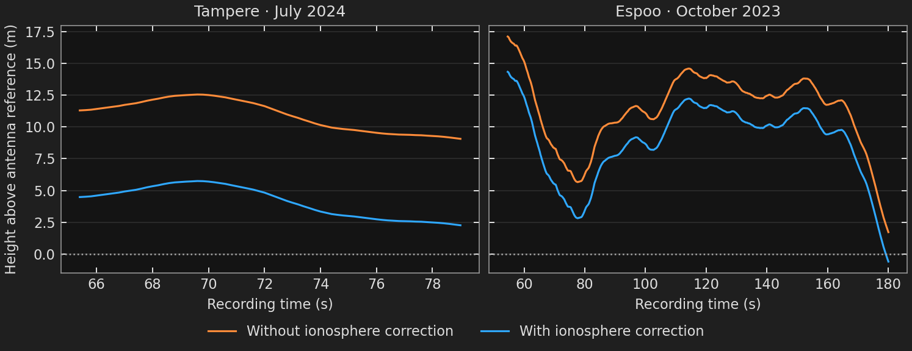

# Height from recorded sky

The Pico Plus 2 starts cold and receives only recorded GPS L1 samples over USB. Antenna coordinates enter the laptop scorer after the run. All heights here are ellipsoidal. The signed error is positive when the receiver places the antenna too high.

## What the Pico measured

For a controlled comparison, the Pico solves each set of satellite measurements twice. Every 200 ms, it copies the satellite states, code times, Dopplers and receive epoch. Twenty milliseconds later it runs a second position solve with ionosphere correction disabled. Each solver keeps its own filter history. Both see the same tracking noise and satellite geometry. The transport still enforces the normal CRC, timing and sample-gap checks. [Bench patch for the measured revision](measurements/height/paired-replay.patch)

| Identical observations on the Pico | Consecutive fixes | Median signed height, before → after | P95 absolute height, before → after | P95 horizontal, before → after | Measured fix rate |
|---|---:|---:|---:|---:|---:|
| Tampere, July 2024 | 69 | +11.32 → +4.50 m | **12.52 → 5.70 m** | 5.84 → 5.41 m | 5.0002 Hz |
| Espoo, October 2023 | 628 | +12.04 → +9.69 m | **14.60 → 12.22 m** | 3.81 → 3.75 m | 5.0000 Hz |

All 69 Tampere fixes used broadcast coefficients that the Pico decoded over the air in the recording. All 628 Espoo fixes used the cold-start baseline. Both runs delivered every 200 ms report with zero sample gaps or input underruns. The small sample count in Tampere covers 13.6 s of valid positions. [Paired status CSVs and transport measurements](measurements/antenna-height.json)



The ordinary 180 s Espoo runs produced **628 consecutive fixes at 5 Hz** each, starting at 54.6 s. Every fix matched in sample time, navigation mask and satellite count. With the cold ionosphere model, p95 absolute height error fell from **14.70 to 12.49 m**. Median signed error fell from +11.85 to +9.46 m. Horizontal p95 was 3.77 m before and 3.74 m after. Both runs finished with zero input gaps or underruns.

Tampere illustrated the cost of poor geometry. In separate cold runs, the original receiver acquired five usable satellites and the corrected receiver acquired four. They each returned 69 consecutive fixes at 5 Hz, starting at 65.4 s. With no matching satellite sets, p95 height went from 12.41 to 14.30 m and p95 horizontal error went from 5.99 to 65.39 m. The four-satellite run had PDOP above 23. The 64.82 s November 2021 capture produced zero valid positions on the baseline Pico before it ended. Both results count toward cold-start availability. [All status records and transport timings](measurements/antenna-height.json)

## Why height moves

On the CTTC rooftop in Spain, both receivers watched the same stationary antenna. Over 223 simultaneous fixes, the Pico's height had a standard deviation of **2.48 m**, while GNSS-SDR's had a standard deviation of **6.40 m**. The median signed difference was +3.53 m. The 95th-percentile absolute difference was 13.81 m. The antenna's absolute height is unknown. [Original comparison](real-sky.md)

All the satellites supplying ranges were high in the sky. Moving the estimated antenna up shortens several predicted ranges by similar amounts, so the solve has trouble distinguishing a height change from a receiver clock change. The five-satellite geometry had a median vertical dilution of precision of **4.32**, versus **2.39** horizontally. With six satellites these fell to **4.04** and **1.71**. Independently tracked code measurements from the same five satellites, projected through identical geometry at 44 shared epochs, differed by **10.26 m vertically at p95**. That calculation removes the satellite-selection difference. Code noise, tracking bias and multipath can all contribute to the residual. [Reproduce the decomposition](../../tools/cttc_height.py) · [Paired observations](measurements/cttc/common-observations.csv.gz)

The original firmware modeled neutral-atmosphere delay. A single-frequency GPS code measurement also includes ionospheric group delay. It varies with elevation and therefore cannot be absorbed into a single receiver clock offset. The ground correction uses GPS broadcast Klobuchar coefficients when a parity-valid LNAV subframe 4, page 18 arrives. During cold start it uses only the model's 5 ns vertical baseline mapped to each satellite's elevation. The Pico evaluates the delay once per satellite per position solve and retains the 4 s carrier-aided code smoother. The ground model applies within the receiver's terrestrial height range, −500 to 9,000 m. [IS-GPS-200N, §20.3.3.5.2.5](https://www.gps.gov/sites/default/files/2025-07/IS-GPS-200N.pdf) · [Decoder and solver](../../receiver/navigation.cpp)

## Antenna references

- **Tampere, Finland.** Antoine Grenier and colleagues recorded the NovAtel GPS-703-GGG rooftop antenna in November 2021 and July 2024. Their archive gives ITRF2014 ECEF **(2795125.165, 1236112.522, 5579646.006) m** at epoch 2022.4, equivalent to **182.482 m** ellipsoid height. Another publication places the named antenna within 0.18 m vertically. The archive does not specify the reference-point offset or survey uncertainty. The 2021 distributed I/Q file is resampled to 10 MS/s. The 2024 real-valued file is 40 MS/s at a 10 MHz IF. [Dataset and readme](https://doi.org/10.5281/zenodo.13683670) · [2021 recording format, Table 1](https://doi.org/10.3390/s24020409) · [Earlier antenna coordinates](https://doi.org/10.3390/data5010018)
- **Espoo, Finland.** Muwahida Liaquat, Saiful Islam and Mohammad Zahidul H. Bhuiyan recorded clean open-sky GPS at FGI's Otaniemi site. The dataset gives **47.248 m** for the antenna. The FGI survey account gives the rooftop PolaNt antenna's AUSPOS-derived ITRF2014 coordinates as **60.182260° N, 24.828537° E**, with the same ellipsoid height. We used the first 180 s of the clean recording, sampled at 26 MS/s with a 6.39 MHz IF. [FGI dataset, scenario 1](https://doi.org/10.23729/9559efea-22fc-48ac-8de4-c4d1cba367be) · [Survey method and coordinates, §6.1 and Table 11](https://aaltodoc.aalto.fi/bitstreams/f3bd9b7d-e36f-430d-9bdb-de87daefa2ea/download)

## What still limits height

In Espoo the receiver never heard the full daytime ionosphere model. The transmitted page IDs place the next page 18 at about 613 s, beyond even the publisher's 471 s file. In a separate host experiment, supplying the actual October 31, 2023 broadcast coefficients lowered p95 absolute height error from **12.05 to 5.18 m** on the same 718 native fixes. The antenna coordinates were used only for scoring. The standalone Pico never received the archived parameters. [NOAA broadcast navigation file](https://noaa-cors-pds.s3.amazonaws.com/rinex/2023/304/brdc3040.23n.gz) · [Matched controls](measurements/antenna-height.json)

More smoothing had a cost. On the same 718 native Espoo fixes, extending the 4 s carrier-aided code smoother to 15 s raised p95 height error from 12.05 to 30.65 m with the ionosphere correction enabled. Ground firmware keeps the 4 s setting. The 15 s setting is available for reproducing the experiment with `EPHEMERIS_LONG_CODE_SMOOTHING=ON`.

## Reproduce a cold run

Download the original waveform from its publisher. Select the named input below. For FGI, choose the clean open-sky scenario. File hashes, input prefixes, native search settings and measured device timing are in the [measurement manifest](measurements/antenna-height.json).

```sh
mkdir -p build/height
python3 tools/import_ground_rf.py tampere24 Novatel_20240731_142746_40MHz_10MHz_8bit_real_gain15.bin build/height/sky.eiq
# For the 180 s Espoo test, use fgi with --milliseconds 180000.
python3 firmware/clocked_replay.py pack build/height/sky.eiq build/height/sky.bin
cmake -S firmware -B build/height/pico -G Ninja -DCMAKE_BUILD_TYPE=Release -DPICO_NO_FLASH=1 \
  -DEPHEMERIS_GROUND_SEARCH=ON -DEPHEMERIS_GROUND_TROPOSPHERE=ON -DEPHEMERIS_GROUND_IONOSPHERE=ON \
  -DEPHEMERIS_DOPPLER_POSITION=ON -DEPHEMERIS_VELOCITY_FIT=ON
cmake --build build/height/pico --target ephemeris_clocked_replay
picotool load -x build/height/pico/ephemeris_clocked_replay.uf2
python3 firmware/clocked_replay.py run PORT build/height/sky.bin build/height/candidate.csv
python3 tools/score_antenna.py docs/software/measurements/height/t24-base.csv.gz build/height/candidate.csv \
  --ecef 2795125.165 1236112.522 5579646.006
```

For the original firmware comparison, set `EPHEMERIS_GROUND_IONOSPHERE=OFF`. The scorer reports every valid fix and a second comparison restricted to matching sample times, navigation masks and satellite counts. The firmware admits new channels as background acquisition finishes, so two physical runs can acquire satellites in a different order. [Clocked replay transport](../../firmware/README.md#clocked-iq-replay-on-the-pico)

To reproduce the simultaneous pair, create a detached checkout of the measured revision and apply the bench patch there. Configure the firmware from that checkout with the ground flags above plus `-DEPHEMERIS_PAIRED_REPLAY=ON`, then build and load the SRAM image as above. The paired host command writes one CSV per solver.

```sh
git worktree add --detach build/height-study 352fe73
git -C build/height-study apply ../../docs/software/measurements/height/paired-replay.patch
cmake -S build/height-study/firmware -B build/height/paired -G Ninja -DCMAKE_BUILD_TYPE=Release -DPICO_NO_FLASH=1 \
  -DEPHEMERIS_PAIRED_REPLAY=ON -DEPHEMERIS_GROUND_SEARCH=ON -DEPHEMERIS_GROUND_TROPOSPHERE=ON \
  -DEPHEMERIS_GROUND_IONOSPHERE=ON -DEPHEMERIS_DOPPLER_POSITION=ON -DEPHEMERIS_VELOCITY_FIT=ON
cmake --build build/height/paired --target ephemeris_clocked_replay
picotool load -x build/height/paired/ephemeris_clocked_replay.uf2
python3 build/height-study/firmware/clocked_replay.py run PORT build/height/sky.bin build/height/on.csv --paired build/height/off.csv
```
