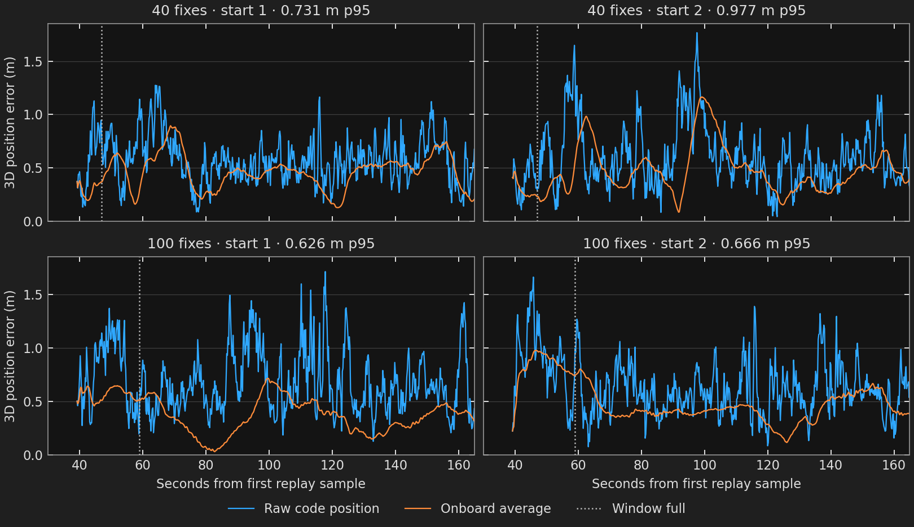

# Motion-corrected position on the Pico

The flight receiver publishes a position as soon as it has a valid fix. At each 200 ms report it uses measured ECEF velocity to bring recent GPS positions forward to that instant, then averages them. The experimental flight build uses 100 fixes, which span 19.8 s. The shorter setting uses 40 fixes over 7.8 s.

## Same 550 km replay

On the physical Pico Plus 2, the 100-fix build reached **0.626 and 0.666 m 3D error at p95** after its window filled. Both starts delivered their first fix at **39.2 s**. From that first fix onward, including warm-up, p95 measured **0.642 and 0.900 m**.

Each cold start used the same 165 s of simulated GPS L1 C/A I/Q on the 150 MHz Pico Plus 2 with no initial position, time or ephemerides. The Pico sent both its raw position and its averaged position from the same navigation solve. The laptop scored both against the generating trajectory. The earlier offline estimate of **0.71 m p95** used only epochs with all 40 fixes in the window. The full-window columns below use that convention. The last column includes every valid fix from cold start. [Earlier raw Pico measurements](orbit-fix.md) · [Recorded CSVs, firmware hashes and transport timing](measurements/motion-average.json)

| Window (fixes) | First fix / satellites used | Full-window epochs | Raw p95, full window | Pico p95, full window | Pico p95, all valid |
| --- | ---: | ---: | ---: | ---: | ---: |
| 40, first prototype | 39.2 s / 8 | 591 | 0.907 m | **0.628 m** | 0.625 m |
| 40, cold start 1 | 39.2 s / 6 | 591 | 0.965 m | **0.731 m** | 0.728 m |
| 40, cold start 2 | 39.2 s / 7 | 591 | 1.216 m | **0.977 m** | 0.967 m |
| 100, cold start 1 | 39.2 s / 5 | 531 | 1.241 m | **0.626 m** | 0.642 m |
| 100, cold start 2 | 39.2 s / 6 | 531 | 1.005 m | **0.666 m** | 0.900 m |



All five runs delivered **630 consecutive positions at 5 Hz**. The laptop received the first position at 39.24 s each time. The Pico consumed every 1 ms input block, with zero gaps or input starvation. Across the five captures its reported position stayed within 0.88 mm of a separate calculation from the rounded CSV values.

At first fix there is one position in the window, so both outputs agree. With uninterrupted 5 Hz fixes from 39.2 s, the 40-fix average fills at 47.0 s and the 100-fix average fills at 59.0 s. Invalid fixes and sample discontinuities clear the history. A cold acquisition can select a different set of satellites on each run. Applying both windows offline to each capture from 59.0 s onward isolates the effect of window length. The 100-fix window reduced p95 by 0.022–0.304 m across the five captures. Its highest p95 in that comparison was 0.749 m.

In the second 100-fix run the report ending at 81.0 s still used PRN 26, the instant the simulator removed it. It was gone by 81.2 s. No later report used that satellite, and no navigation solution used unhealthy PRN 22.

## How the Pico computes the average

For two consecutive fixes, let `p` be the raw ECEF position and `v` the reported Doppler velocity after the five-fix velocity fit. Over 0.2 s, trapezoidal integration gives a displacement of `0.1 × (v_previous + v_current)` metres. The receiver stores the difference between that displacement and the observed change in code position. This difference is typically small even when the spacecraft moves more than a kilometre per report.

With N fixes in the window, the oldest difference corrects one position and the newest corrects N−1. The Pico multiplies each difference by that count, sums them, divides by N and adds the result to the latest raw position. Subtracting the ECEF positions in double precision preserves small differences at orbital radii. Storing those differences in three floats uses **536 bytes** of filter state at 40 fixes or **1,256 bytes** at 100. Recomputing the weighted sum from the ring at each report bounds roundoff over long runs. [Receiver implementation](../../receiver/navigation.cpp) · [Reset, impulse and 300,000-epoch tests](../../tests/navigation_test.cpp)

A longer window also integrates velocity bias for longer. After the window fills, a constant velocity bias of 0.1 m/s along one axis contributes 0.39 m on that axis at 40 fixes or 0.99 m at 100. The test orbit gives us known truth for this trade.

## Other orbit segments

The native C++ receiver replayed four additional I/Q recordings with both windows. The comparison uses the same epochs after both filters filled. Every non-position status field matched the original raw receiver across all 825 reports in each run.

| Orbit altitude / phase | First fix | 40-fix p95 | 100-fix p95 |
| --- | ---: | ---: | ---: |
| 400 km / 103° | 39.2 s | 1.00 m | 0.68 m |
| 475 km / 151° | 39.2 s | 0.93 m | 0.56 m |
| 800 km / 211° | 39.2 s | 1.13 m | 0.85 m |
| 400 km / 281° | 33.2 s | 1.79 m | 1.22 m |

Including warm-up on the last arc gives 1.93 m p95 for the 100-fix build. The 0.71 m target applies to the particular 550 km replay. The held-out arcs show how geometry and early fixes affect other starts. [Native replay scores and input hashes](measurements/motion-average.json)

## Processing cost

The normal half-chip tracker also packs two adjacent sign pairs together when a sample block starts at IF phase zero. On the 150 MHz M33, processing one millisecond of ADC input took **131.45 µs on average**, down from **164.71 µs** across 512 measured blocks. Peak time fell from 168 to 137 µs. All packed words matched. This saves about 4,990 cycles per millisecond in this stage. The full Pico replay separately checks every input epoch and every 5 Hz output. [Packing code](../../receiver/coarse.cpp) · [Pico timing and checksums](measurements/motion-average.json)

## Reproduce

Use a checkout of Pico SDK 2.2.0 with `PICO_SDK_PATH` set. These flags build the experimental flight configuration and its SRAM replay image. Set `EPHEMERIS_MOTION_WINDOW=40` to repeat the original 7.8 s experiment. The live receiver keeps its usual status columns. The clocked bench appends raw ECEF and the current window fill for paired scoring.

```sh
cmake -S firmware -B build/motion -G Ninja -DCMAKE_BUILD_TYPE=Release \
  -DPICO_NO_FLASH=ON -DEPHEMERIS_FLIGHT_SURVEY=ON -DEPHEMERIS_COMPACT_SURVEY=ON \
  -DEPHEMERIS_VELOCITY_FIT=ON -DEPHEMERIS_MOTION_AVERAGE=ON -DEPHEMERIS_MOTION_WINDOW=100
cmake --build build/motion --target ephemeris_pico ephemeris_clocked_replay
picotool load -x build/motion/ephemeris_clocked_replay.uf2
python3 firmware/clocked_replay.py run PORT orbit-165s.bin motion.csv
python3 tests/independent_orbit.py --score-smoothing motion.csv --seconds 165 --window-fixes 100
```

To score the archived runs directly, pass the compressed status CSV to the same scorer. [Generate the independent orbital recording](independent.md#recreate-the-reference-input) · [Prepare the USB waveform](../../firmware/README.md#clocked-iq-replay-on-the-pico)
