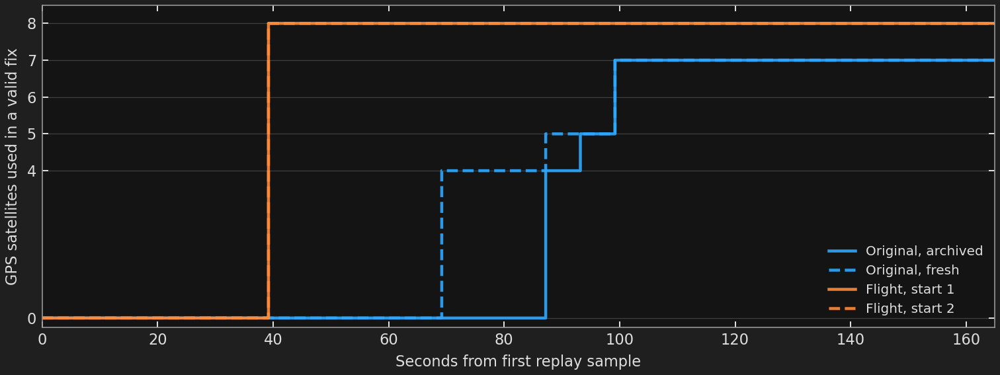

# Time to an orbital fix

On two cold starts, the RP2350B got a position from **eight GPS satellites at 39.2 s** on the same 550 km replay. The laptop received both first positions at 39.24 s. They were **0.52 and 0.53 m** from truth. Each run delivered 630 consecutive positions at 5 Hz. The previous two cold starts on this waveform first used seven satellites at **99.2 s**.

## What the Pico did

The Pico Plus 2 ran at 150 MHz on both Cortex-M33 cores. Each cold start loaded an empty receiver into SRAM. The laptop streamed the same 165 s of compact GPS L1 C/A I/Q under the Pico’s 1 kHz clock. The Pico searched blindly across the 32 GPS C/A codes, tracked code and carrier, decoded broadcast navigation data and solved position, velocity and time. Antenna trajectory, satellite list and time of day were available only to the scorer. The RF board and antenna are outside this digital test. [Waveform generation](independent.md#recreate-the-reference-input) · [USB replay procedure](../../firmware/README.md#clocked-iq-replay-on-the-pico)

A satellite counts here when its observation contributes to a receiver-valid position. The first production run reported one tracking lock at 1.2 s and four at 4.6 s. Its first position had to wait for the parity-checked satellite clock and ephemeris data. Times below start at the first I/Q sample and are resolved to the 200 ms reporting interval.

| Cold Pico run | First fix | Six used | Seven used | Eight used | Fixes | 3D position / velocity error, p95 |
| --- | ---: | ---: | ---: | ---: | ---: | ---: |
| Original, archived | 87.2 s | 99.2 s | 99.2 s | — | 390 | 1.22 m / 0.111 m/s |
| Original, fresh | 69.2 s | 99.2 s | 99.2 s | — | 480 | 1.29 m / 0.095 m/s |
| Full-size search control | 69.2 s | 99.2 s | 99.2 s | 117.2 s | 480 | 1.17 m / 0.109 m/s |
| Rolling prototype | 39.2 s | 39.2 s | 69.2 s | 69.2 s | 630 | 0.94 m / 0.076 m/s |
| Flight, start 1 | 39.2 s | 39.2 s | 39.2 s | 39.2 s | 630 | 1.05 m / 0.071 m/s |
| Flight, start 2 | 39.2 s | 39.2 s | 39.2 s | 39.2 s | 630 | 1.04 m / 0.071 m/s |



The two flight runs in the plot overlap at every epoch. Both used PRNs 4, 8, 10, 16, 21, 27, 31 and 32 at first fix, with PDOP 1.70. The peak processing lateness was 3.39 ms or less on each run, with zero input gaps or underruns.

The full-size FFT control keeps the faster tracker and replay byte expansion, and switches only the search profile. On the 330 shared epochs from 99.2 s onward, the control’s 3D position error was 0.89 m at p95. Both flight runs measured 1.17 m at p95 on those epochs. Their full-run scores include the earlier fixes. Each run gets its own start because interrupt timing can change which signals a blind search confirms before the next broadcast subframe. [Status CSVs, USB times, input hash and independent scores](measurements/orbit-fix.json)

## What changed

The flight survey fits the 1,023-chip C/A period into 1,024 cells. Its local replica weights the two chips that overlap each cell. Two spectra offset by half a cycle per millisecond give 500 Hz Doppler spacing. The Pico tries ±45 kHz on every code, then ±70 kHz. After that, it interleaves four quick searches with one full-resolution, four-dwell search and rotates through all 32 codes. Fresh I/Q must independently confirm each detection. The full-resolution fallback still recovers a 40 dB-Hz test signal. On the single-transmitter matrix, the compact path confirmed all 32 transmitted codes and zero of 992 absent-code trials at each of two spacings, 1 and 9 ms. [Acquisition and confirmation](../../receiver/signal.cpp) · [Search order](../../receiver/app.cpp)

An early version reached seven by 39.2 s in signal time but fell **3.60 s** behind the clock by the end of the replay. The flight tracker now uses the M33 DSP byte-sum instruction for correlation counts and hardware rounding for prompt sums. The USB bench also expands four I/Q pairs with one table lookup. Acceptance requires all 825 status reports, zero missing input and less than 4 ms peak lateness at the 1 ms input epochs. [Tracker](../../receiver/coarse.cpp) · [Bench timing checks](../../firmware/clocked.cpp)

Five native cold replays at 400–800 km reached seven usable satellites by 39.2 s with a fixed work budget. Three more native starts discarded 7, 17 or 29 s of the primary recording and restarted the receiver from scratch. Those reached seven in **32.2–40.2 s**. In the +7 s case the eighth took 122.2 s. These are host signal-time measurements. The physical runs in the table cover one simulated orbit segment. [Native inputs, timing and truth scores](measurements/orbit-fix.json)

## Does lowering the output rate buy accuracy?

On the first production run, the recorder received 630 valid 5 Hz fixes. We compared the raw position with a causal average of the last 40 positions, moving each position forward to the current epoch by integrating the receiver’s measured ECEF velocity. The simulated receiver was moving at 7.67 km/s in ECEF at first fix. Even a plain average of five 5 Hz positions would lag the latest position by about 3.1 km (0.4 s at that speed). The motion-corrected window below spans 7.8 s. Every filtered position uses only data already received. No orbital truth enters the filter.

| Output cadence after the window fills | Compared epochs | Raw 3D error, p95 | Motion-corrected average, p95 |
| --- | ---: | ---: | ---: |
| Every Pico fix, 5 Hz | 591 | 1.07 m | **0.71 m** |
| Every fifth Pico fix, 1 Hz | 119 | 1.02 m | **0.70 m** |

Both calculations produce the same estimate at each shared timestamp. Their percentiles differ because the 1 Hz series contains fewer samples. Averaging helped on this smooth orbit. Simply transmitting fewer reports adds no range or carrier information. The published firmware numbers in the first table are the Pico’s directly emitted positions. The averages in this table were computed on the laptop. [Scorer](../../tests/independent_orbit.py)

## Reproduce

Configure the live flight profile with `EPHEMERIS_FLIGHT_SURVEY=ON`, `EPHEMERIS_COMPACT_SURVEY=ON` and `EPHEMERIS_VELOCITY_FIT=ON`. The Pico build enables dual-core half-chip tracking. For the SRAM USB test, also set `PICO_NO_FLASH=ON` and build `ephemeris_clocked_replay`. Disable only `EPHEMERIS_COMPACT_SURVEY` for the full-size control. [Build and replay commands](../../firmware/README.md#clocked-iq-replay-on-the-pico)

```sh
trace=docs/software/measurements/clocked/orbit_fix_flight1.csv.gz
python3 tests/independent_orbit.py --score "$trace" --seconds 165
python3 tests/independent_orbit.py --rate-trial "$trace" --seconds 165
```
