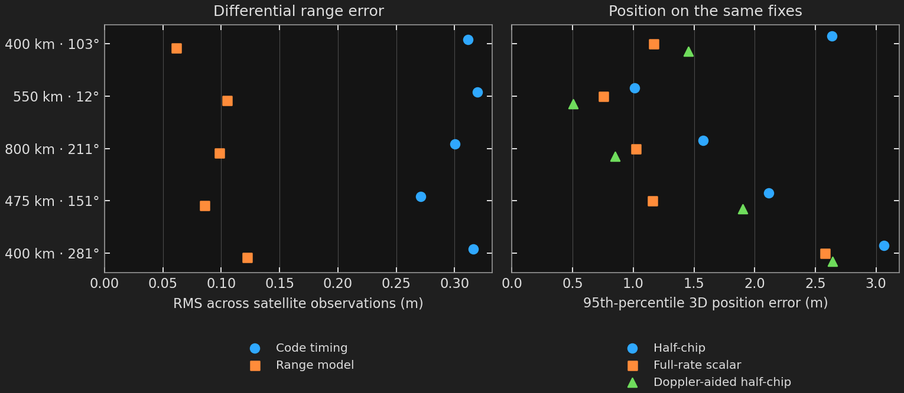

# Where the position error comes from

On the 400 km, 103° replay, the half-chip receiver recovered each satellite's code timing to **0.31 m RMS** after removing the common receiver clock offset. That is about one nanosecond. The directions of the satellites amplified those timing errors into **2.34 m** of 95th-percentile 3D position error. The complete receiver measured **2.64 m**. Over 540 fixes the radial, along-track and cross-track RMS errors were **1.17, 0.40 and 0.34 m**. About 83% of the mean squared position error was radial.

## The same range error can produce different positions

The receiver estimates three coordinates and its clock from the arrival times of satellite codes. Poor angular separation makes some combinations difficult to distinguish. A small change in several ranges can then move the estimated position substantially along one axis. Position dilution of precision (PDOP) describes this geometry. It predicts sensitivity to range errors. Each measured 3D error below is the distance from the known position at the sample epoch. [ESA geometry derivation](https://gssc.esa.int/navipedia/index.php?title=Positioning_Error)

| Orbit and starting phase | Median PDOP | Code timing, range RMS | Code timing alone, 3D p95 | Range model alone, 3D p95 | Measured 3D p95 |
| --- | ---: | ---: | ---: | ---: | ---: |
| 400 km · 103° | 3.72 | 0.31 m | 2.34 m | 0.62 m | 2.64 m |
| 550 km · 12° | 1.74 | 0.32 m | 0.96 m | 0.23 m | 1.01 m |
| 800 km · 211° | 1.96 | 0.30 m | 1.50 m | 0.34 m | 1.57 m |
| 475 km · 151° | 1.92 | 0.27 m | 2.08 m | 0.40 m | 2.12 m |
| 400 km · 281° | 2.68 | 0.32 m | 2.66 m | 1.03 m | 3.07 m |

The diagnostic compares each decoded satellite transmit time against the pseudorange that GPS-SDR-SIM used to drive its code generator. This **code-timing** term includes waveform sampling, added noise, quantization, correlation and tracking-loop interpolation. The **range-model** term is the remaining difference between the generator's ranges and the receiver's ranges at the true position, including their satellite clock, orbit and signal travel time calculations. We remove the common clock at each epoch and use the actual satellite directions to project both terms into 3D. The resulting vectors add at each fix. Their separately calculated percentiles do not add. [Generator code](https://github.com/osqzss/gps-sdr-sim/blob/28ca29a6719475195e3aabd5930c4ed02d67190f/gpssim.c) · [Per-case measurements](measurements/position-budget.json)

## Change the tracker, hold the satellites fixed



At 400 km and 103°, the full-rate scalar tracker cut position error from **2.64 to 1.17 m**. Both builds used the same waveform, satellites and epochs for every fix. The scalar tracker preserves finer sample timing and amplitude information. This comparison measures the combined effect of the two tracking implementations. On the same recording, enabling the existing Doppler-aided position estimate on the half-chip receiver brought **2.64 down to 1.45 m**. Both controls improved position on each of the five recordings, including the last two trajectories selected before scoring. [Matched counts and output hashes](measurements/position-controls.json) · [Doppler-aided estimator](accuracy.md#doppler-aided-position-at-5-hz)

Removing the injected Gaussian noise alone did little for position in one control. We restricted both cold searches to the same eight PRNs at 400 km and 103° to prevent a change of satellite geometry. With the half-chip tracker, p95 was **1.83 m with the original noise and 1.94 m with it disabled**, across 630 matched fixes. The signals still shared a quantized ADC stream. This experiment measures the effect of that noise setting for one fixed ensemble. [Control inputs](measurements/position-controls.json)

We also tested a seven-report velocity fit on the host. It improved velocity error on all six ground and orbital cases, while all 4,950 status rows retained identical position and other nonvelocity fields. At 400 km and 103° the velocity p95 moved from 0.231 to 0.208 m/s, still above the 0.200 m/s target. The seven-report fit spans 1.2 s and has a larger transient error under jerk. To reproduce the host estimate, replay with the velocity fit disabled and apply endpoint weights `[-5, -2, 1, 4, 7, 10, 13] / 28` to seven consecutive raw ECEF velocities, oldest first. Pass through the first six after a reset, invalid fix or skipped epoch. The published flight profile uses five reports. [Velocity controls and coefficients](measurements/velocity-span.json)

These independent 165-second recordings disable the simulator's ionospheric delay and have no injected multipath or hardware oscillator drift. An antenna or conducted RF test is needed to measure the physical error budget. Separate ground simulations exercise atmosphere and reflections. [Ground propagation controls](accuracy.md#biases-in-the-ground-experiment)

## Reproduce the budget

Generate the independent orbital EIQ files with the pinned simulator, start time, gain and noise settings. The final two cases use (475 km, 151°, seed 62031) and (400 km, 281°, seed 73919). Run the diagnostic from a checkout containing the receiver revision recorded in the JSON. It uses Python 3.12+, NumPy, CMake and native C/C++ compilers. The source instrumentation and build are temporary. [Waveform generation](independent.md#recreate-the-reference-input)

```sh
python3 tests/position_budget.py "$SIM" \
  --case 400 103 7411 heldout-400.eiq --case 550 12 10209 orbit-165.eiq \
  --case 800 211 9203 heldout-800.eiq --case 475 151 62031 475-151.eiq \
  --case 400 281 73919 400-281.eiq > position-budget.json
```

For the paired tracking comparison, set `EPHEMERIS_FLIGHT_SURVEY=ON` and `EPHEMERIS_VELOCITY_FIT=ON` in each native build. Select `EPHEMERIS_COARSE_TRACKING=ON` for the half-chip reference, switch it off for the scalar control, or enable `EPHEMERIS_DOPPLER_POSITION=ON` alongside half-chip tracking for the position smoother. Replay the same EIQ with `--work 1141/5706`. The comparison command checks the entire 5 Hz grid and the satellites used before scoring.

```sh
python3 tests/independent_orbit.py --compare-position half-chip.csv scalar.csv \
  --seconds 165 --altitude-km 400 --phase-deg 103
```
