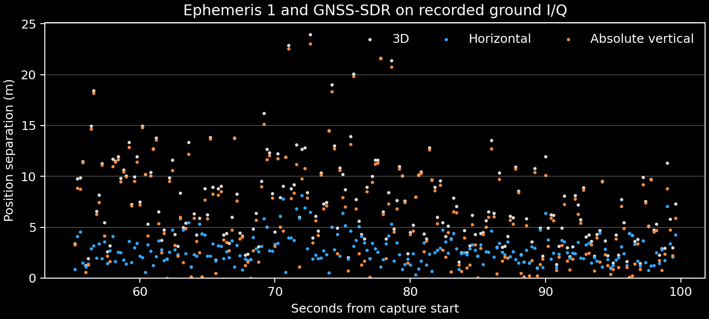
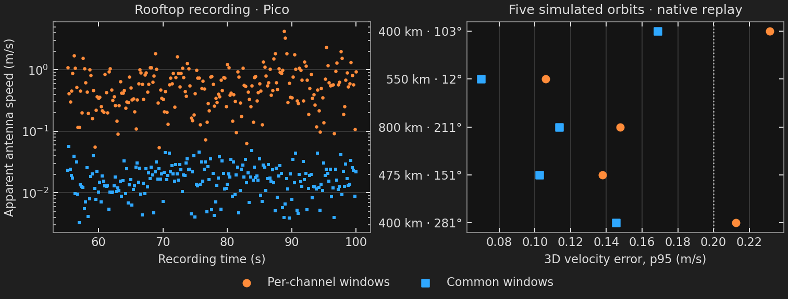

# A cold fix from recorded sky

CTTC recorded 100 seconds of GPS L1 in Castelldefels, Spain, on April 4, 2013. The original front end sampled complex baseband at 4 MS/s and saved signed 16-bit I and Q. For this replay the receiver starts with empty tracking channels and navigation state. Its only input is the waveform. [GNSS-SDR recording and example fix](https://gnss-sdr.org/my-first-fix/)

The 150 MHz Pico Plus 2 returned its first position at **41.274846° N, 1.987684° E, 81.69 m WGS 84 ellipsoid height**. The laptop received it 55.24 s after the USB handshake. The Pico used five satellites for that fix and decoded PRNs 1, 11, 17, 20, 23 and 32 during the recording.

The six channels filled the first six tracking slots in that order. Core 1 correlated PRNs 1, 17 and 23. Core 0 correlated PRNs 11, 20 and 32 between acquisition work. [Work on the two Pico cores](receiver.md#work-on-the-two-pico-cores)

| Pico measurement | Result |
| --- | ---: |
| First satellite lock / four locks, laptop clock | 1.44 s / 26.64 s |
| Consecutive valid fixes | 225 over 44.80 s from first to last |
| Measured fix rate | 5.0001 Hz |
| Sample gaps / input underruns | 0 / 0 |
| Apparent speed of the stationary antenna, p95 | 1.53 m/s |

The native receiver reached a six-satellite fix at 25.2 s of recording time with eight search steps per millisecond. A second native run used the same compact input as the Pico and a search budget calibrated on the target. Its first position came at 55.2 s. [Run settings, input hashes and scores](measurements/cttc/report.json)

GNSS-SDR 0.0.19 independently processed the original 4 MS/s recording. Of the Pico's 225 fixes, 223 fell within the reference's 10 Hz time series. Median separation was **2.56 m horizontally** and **6.11 m in 3D**. At the 95th percentile it was **5.80 m horizontally**, **13.75 m vertically** and **13.94 m in 3D**. The height difference accounts for most of the larger excursions in the plot.



The capture notes identify a NovAtel GPS-600 on the CTTC roof. Their approximate coordinates disagree with the archived GNSS-SDR track and both fresh solutions. We have no surveyed antenna position for this recording, so these figures measure agreement between receivers. [CTTC site](https://www.cttc.cat/contact/) · [Original recording](https://gnss-sdr.org/my-first-fix/)

## Doppler on a stationary antenna

In the first Pico replay above, the stationary antenna’s apparent speed was 1.53 m/s at the 95th percentile. Each tracking channel used to start its Doppler averaging window when it acquired a satellite. The six channels therefore sampled a changing receiver oscillator over different intervals. Their shared frequency error could appear as a difference between satellites and enter the velocity solve.

The receiver now collects carrier phase over common 200 ms intervals and estimates Doppler at the navigation epoch. On the **same Pico and recorded samples**, apparent speed fell to **0.038 m/s at p95**. Both builds returned their first position at 55.2 s and produced 225 consecutive fixes at 5 Hz. The new build used five to six satellites. Its p95 horizontal separation from GNSS-SDR was **5.74 m**, and its p95 3D separation was **14.12 m**, compared with 5.80 m and 13.94 m on the first build. This change improves velocity. Height remains the larger source of positional disagreement. [Tracking implementation](../../receiver/signal.cpp) · [Hardware status, hashes and orbital controls](measurements/doppler-windows.json)



Both native builds used identical lock masks, navigation masks and satellite counts on every report of the five orbital arcs. Velocity error improved on all five. On the 400 km, 103° arc it dropped from 0.231 to 0.169 m/s at p95, with a position error of 2.64 m in both runs. An independent regression test feeds a common frequency variation into two trackers that acquire at different times, then restarts one tracker and checks their differential Doppler again. [Regression test](../../tests/signal_test.cpp)

The Pico also replayed the 550 km simulated orbit for 165 s. It produced its first position at 87.2 s and delivered 390 consecutive fixes. Against the simulated trajectory, the new build had a p95 3D position error of 1.22 m and a p95 3D velocity error of 0.111 m/s. Background acquisition admitted different satellites in the two hardware runs. On the 60 fixes with matching times, satellite counts and navigation masks, p95 velocity error fell from 0.360 to 0.254 m/s. [Pico orbital status](measurements/clocked/orbit_165_aligned.csv.gz) · [Paired scores](measurements/doppler-windows.json)

We also tried a running mean of the original Pico positions with the antenna explicitly assumed stationary. Over the final 111 time-matched fixes it raised p95 3D separation from 11.46 to 13.94 m. The mean retained the higher early height estimates. The receiver continues to report a moving-capable position.

[Height error against two antenna references](height.md)

## Reproduce the replay

Download the archive from the publisher and check its SHA-256 before unpacking. [Original CTTC archive and checksum](https://sourceforge.net/projects/gnss-sdr/files/data/2013_04_04_GNSS_SIGNAL_at_CTTC_SPAIN.tar.gz/download)

```sh
mkdir -p build/cttc
cd build/cttc
name=2013_04_04_GNSS_SIGNAL_at_CTTC_SPAIN
curl -fL "https://downloads.sourceforge.net/project/gnss-sdr/data/$name.tar.gz" -o source.tar.gz
echo "d5b926aefe7462ca4211bcae2129591a810fa4960a214f35d056a883aa2af3ff  source.tar.gz" | shasum -a 256 -c -
tar -xzf source.tar.gz "$name/$name.dat"
cd ../..
python3 tools/import_cttc.py "build/cttc/$name/$name.dat" build/cttc/cttc.eiq
python3 firmware/clocked_replay.py pack build/cttc/cttc.eiq build/cttc/sky.bin
```

The adapter resamples by 1023/250, shifts baseband to +4.092 MHz, then quantizes each axis to the board's two-bit format. Its fixed magnitude threshold is the per-axis RMS over the first 100 ms, 122.59 input counts. For USB full-speed the host packs each half-chip into two sign bits. Acquisition, tracking, navigation-message decoding and the position solve all run on the Pico.

```sh
cmake -S firmware -B build/cttc/pico -G Ninja -DCMAKE_BUILD_TYPE=Release \
  -DPICO_NO_FLASH=1 -DEPHEMERIS_GROUND_SEARCH=ON -DEPHEMERIS_GROUND_TROPOSPHERE=ON \
  -DEPHEMERIS_DOPPLER_POSITION=ON -DEPHEMERIS_VELOCITY_FIT=ON
cmake --build build/cttc/pico --target ephemeris_clocked_replay
picotool load -x build/cttc/pico/ephemeris_clocked_replay.uf2
python3 firmware/clocked_replay.py run PORT build/cttc/sky.bin build/cttc/pico.csv
```

Score the archived Pico fixes against the independent receiver, or substitute the CSV from a new replay. [Reference receiver configuration](measurements/cttc/reference.conf) · [Pico bench setup](../../firmware/README.md#clocked-iq-replay-on-the-pico)

```sh
data=docs/software/measurements/cttc
python3 tools/compare_ground.py "$data/pico-aligned.csv.gz" "$data/gnss-sdr.csv.gz" --plot build/cttc/separation.png
```

GNSS-SDR used the archive date to select GPS week 1734. Ephemeris decoded week 710 modulo 1024. For the comparison, each published GNSS-SDR GPX epoch was matched to its double-precision ECEF position in the RTKLIB binary log. We subtracted the fitted receiver clock offset from its receive time, then interpolated the reference position at each Pico fix time. The scorer excludes times outside the reference and gaps longer than 0.15 s.

To regenerate the reference with GNSS-SDR 0.0.19, use a fresh output directory so the GPX belongs to this run.

```sh
mkdir -p build/cttc/reference
cd build/cttc/reference
gnss-sdr --config_file=../../../docs/software/measurements/cttc/reference.conf
python3 ../../../tools/cttc_reference.py pvt.dat pvt_*.gpx > reference.csv
```
