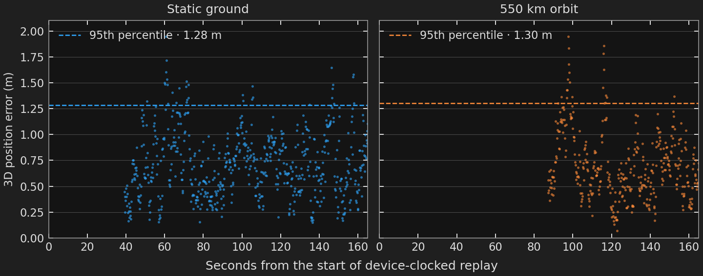
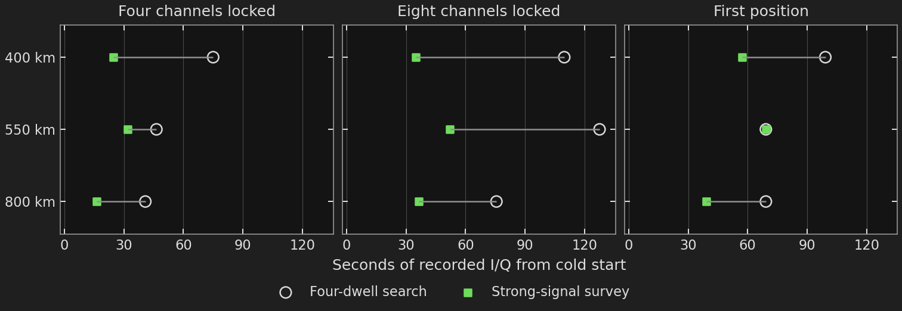
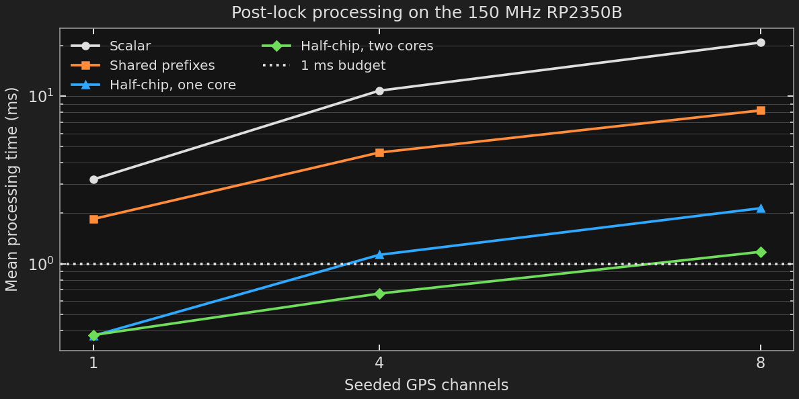
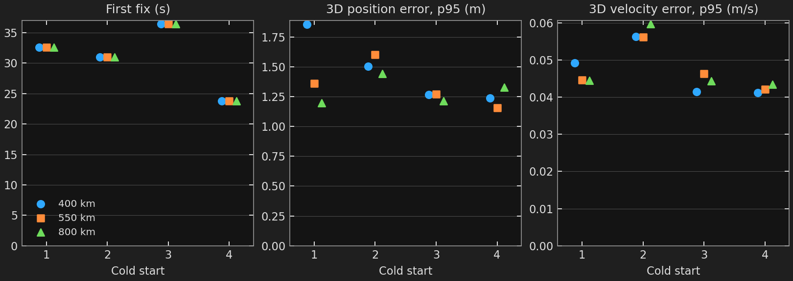
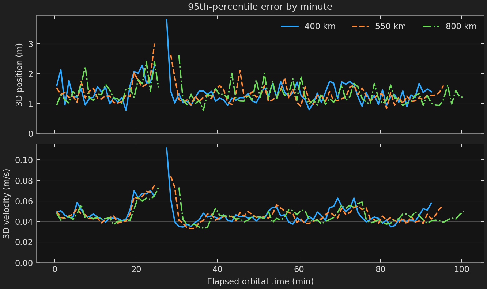
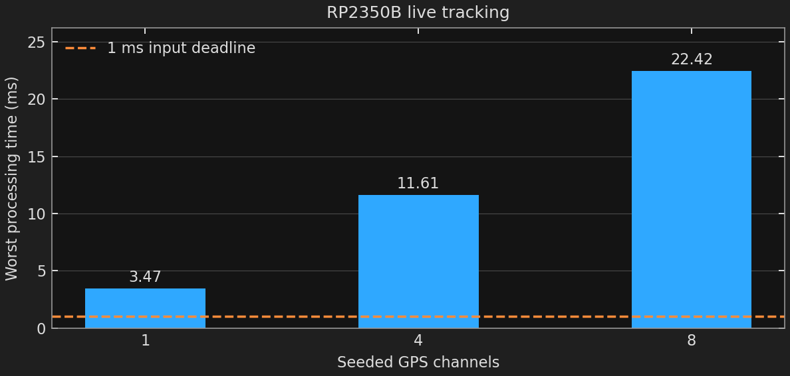

# Receiver measurements

The latest 550 km cold trials measure the time to the first position and to six, seven and eight satellites in a fix. [Orbital fix timing on the Pico](orbit-fix.md)

The Pico kept 5 Hz while correcting the height of two real rooftop antennas. [Height against antenna references](height.md)

[Real antenna recording on the Pico](real-sky.md) · [3D position error budget](position-error.md) · [Cold-search timing and accuracy](accuracy.md#time-from-cold-start) · [Independent ground and orbital replay](independent.md#cold-search-at-a-fixed-work-rate)

## Device-clocked replay on the Pico

In the earlier ground and orbit comparison, the 150 MHz Pico Plus 2 ran cold acquisition, tracking, LNAV decoding and the navigation solver on two independent 165-second recordings. The laptop supplied half-chip I/Q signs over USB and measured when each fix arrived. Both recordings completed with zero input gaps or underruns. Each run started from an empty receiver in SRAM. The RF front end and antenna are outside this bench.

| Recorded motion | First satellite lock | Four locks | First position on laptop | Consecutive fixes | Wall-clock rate | 3D position / velocity error, p95 |
| --- | ---: | ---: | ---: | ---: | ---: | ---: |
| Static ground | 1.44 s | 11.84 s | 39.24 s | 630 | 5.0001 Hz | 1.28 m / 0.188 m/s |
| 550 km orbit | 5.04 s | 40.64 s | 87.24 s | 390 | 4.9998 Hz | 1.30 m / 0.161 m/s |

Times start at the USB replay handshake. The Pico starts its 1 kHz clock after filling 64 ms of input. Ground fixes used five to six satellites and orbital fixes used four to six. Every reported lock matched a satellite transmitted at that epoch. The first five consecutive reports within both 10 m and 0.2 m/s began at 39.2 s of recording time on the ground and 89.0 s in orbit. [Firmware settings, timing and truth scores](measurements/pico-clocked.json) · [Bench procedure](../../firmware/README.md#clocked-iq-replay-on-the-pico)



Two shorter trials used the same 65 seconds of ground I/Q. The unfiltered run missed the 0.200 m/s velocity threshold at 0.2065 m/s p95. Enabling the five-report velocity fit brought it to 0.1772 m/s. Both runs used the same six satellites at all 130 fixes and delivered the first position at 39.24 s. Applying the same fit offline to the original velocity reports gives 0.1770 m/s. [Velocity fit](independent.md#five-report-velocity-fit)

These commands score the archived Pico reports against the independent trajectories.

```sh
python3 tests/independent_static.py docs/software/measurements/clocked/ground_165.csv.gz --seconds 165
python3 tests/independent_orbit.py --score docs/software/measurements/clocked/orbit_165.csv.gz --seconds 165
```

## Cold search in the host simulation



In the 550 km simulation the strong-signal survey reached eight tracked satellites 75.4 seconds earlier. Both versions produced their first position at 69.2 seconds. A position also needs decoded satellite clocks and orbits. All three simulations used the same search budget calibrated on the Pico. [Measurements and receiver settings](measurements/flight-survey.json)

[Lock times, bias experiments and accuracy at 5 Hz](accuracy.md) · [Outdoor ground fix](ground.md)

## Post-lock timing on the Pico Plus 2

The 150 MHz RP2350B has 1,000 µs before the next millisecond of I/Q arrives. At eight locked channels the two-core half-chip tracker averaged **825 µs** and peaked at **872 µs**. An on-chip sample clock drove real PIO and DMA traffic. The receiver processed a repeating synthetic GPS epoch with seeded code phases. Each channel count retained every requested lock for 990 scored epochs and dropped zero input blocks.

| Locked GPS channels | Mean processing | Worst processing | Time left at the worst epoch |
| ---: | ---: | ---: | ---: |
| 1 | 305 µs | 363 µs | 637 µs |
| 4 | 495 µs | 557 µs | 443 µs |
| 6 | 662 µs | 718 µs | 282 µs |
| 8 | 825 µs | 872 µs | 128 µs |



The plot compares compute-paced runs that held the requested locks. At eight channels the scalar reference averaged 20.908 ms, shared prefix sums took 8.229 ms, and half-chip tracking took 1.441 ms on one core or 0.824 ms on two. That is a 25.4× reduction from scalar to two-core tracking. The half-chip correlator trades sensitivity for speed. Against the full-rate reference it lost 4.39 dB of coherent prompt SNR in the 47 dB-Hz noise test. [Correlator test](../../tests/coarse_test.cpp) · [Tracking implementation](receiver.md#half-chip-tracking-on-the-pico)

Three further runs added a six-satellite position and velocity solve every 200 ms with all eight trackers active. All 15 fixes passed independent reference checks. The longest combined processing burst took 2,642 µs. Peak DMA backlog was 21,908 bytes in a 32,768-byte ring. Each burst drained to less than one input block within 13 epochs, with zero lost blocks or locks. The solver received known observations independent of the tracking fixture. The cold replay below measures a fix produced from raw samples. [Measurements and firmware hashes](measurements/baseline.json) · [Bench commands](../../firmware/README.md)

## Cold starts from raw I/Q

The simulated sky contains 24 moving GPS satellites. Each 150-second recording starts with an empty receiver. Signals above the 5° antenna mask are summed, mixed with noise and quantized to the four-bit ADC format. The replay gets only those samples. It searches PRNs 1–32, tracks up to eight channels, decodes LNAV and solves position, velocity and receiver clock at 5 Hz. In these runs, five to eight satellites contributed to each valid fix.


In this 550 km start the first truth-checked fix came at 32.6 s. A carrier can lock well before its navigation words arrive.



All 12 scalar starts passed. The first of five consecutive truth-checked fixes arrived in 23.8–36.4 s. Across the runs, 95th-percentile 3D errors were 1.16–1.86 m in position and 0.041–0.060 m/s in velocity. All 7,155 eligible epochs after first fix produced a valid solution. A half-chip build also passed all twelve starts, with per-run 95th-percentile errors of 2.31–4.16 m and 0.078–0.131 m/s across 7,152 eligible epochs. These numbers describe an idealized RF source with a known antenna pattern, broadcast clocks and orbits. Flight adds oscillator, antenna, atmosphere and broadcast-model errors. [Per-run values and hashes](measurements/baseline.json) · [Cases and gates](../../tests/scenarios.json)

### Complete orbits from raw I/Q

The native scalar reference processed 4 h 49 min of synthetic GPS I/Q across three cold starts. Inertial speeds were 7.669, 7.585 and 7.452 km/s at 400, 550 and 800 km respectively. Each replay covered one full receiver orbit from the first start phase. All 82,768 eligible epochs after first fix returned valid solutions at the scheduled 5 Hz signal-time cadence. An eligible epoch had at least six healthy signals at or above 40 dB-Hz and a truth PDOP of 3 or better.

| Altitude | Recording | First of five truth-checked fixes | Valid / eligible epochs | 3D position error, p95 | 3D velocity error, p95 |
| ---: | ---: | ---: | ---: | ---: | ---: |
| 400 km | 5,554 s | 32.6 s | 26,577 / 26,577 | 1.384 m | 0.0476 m/s |
| 550 km | 5,739 s | 32.6 s | 27,400 / 27,400 | 1.357 m | 0.0471 m/s |
| 800 km | 6,053 s | 32.6 s | 28,791 / 28,791 | 1.351 m | 0.0465 m/s |



Minute bins contain valid, eligible epochs beginning at first fix. The table gives the percentile over each entire scored run. [Orbit measurements, seeds and hashes](measurements/baseline.json) · [Replay procedure](receiver.md#leo-acceptance)

### Controlled range errors

On the same 550 km start, imposing a 10 TECU mean slant electron content with a ±50% variation per link and a 1 m peak satellite range bias raised the 95th-percentile position error from 1.36 m to 2.80 m. First fix remained at 32.6 s. At L1, each TECU delays the code by 0.162 m and advances the carrier by the same distance. Each satellite's imposed variation follows a 30-minute sinusoid with its own phase. This experiment isolates sensitivity to those inputs. A flight-condition prediction needs measured topside electron content and broadcast orbit/clock residuals. [First-order ionospheric delay](https://gssc.esa.int/navipedia/index.php/Ionospheric_Delay)

The 260-second fault replays also exercised signal loss. The receiver invalidated its fix during the 10-second total outage and recovered 12.6 s after signal returned. With only three visible satellites it stayed invalid and recovered 26.4 s after visibility returned. A software warm reset at 180 s cleared the fix. A fresh truth-checked fix returned 32.6 s after reset. The archived results include clock offsets of ±2 ppm, a 24 dB fade on one signal and the rotating antenna case. [Fault results](measurements/baseline.json)

An independent waveform generator supplied a static recording and a 90-second 550 km recording using archived broadcast ephemerides. In the orbital run the half-chip receiver reached its first fix at 33.2 s and returned 285 consecutive fixes with 95th-percentile errors of 0.83 m and 0.172 m/s. [Independent baseband replay](independent.md)

## Capture and scalar timing

The RP2350B ran at 150 MHz from SRAM. A PIO pattern generator supplied a nominal 16.368 MHz clock and a known sequence. The digital capture matched all 163,680 samples. A second check compared four parallel one-bit PIO inputs with the packed four-pin input on the same edges and found zero differences. The clock monitor detected 10 µs interruptions at both high and low levels. A 270-second endurance run captured 4,419,360,000 samples in contiguous millisecond blocks with zero gaps, missed blocks or FIFO stalls. These measurements use the unwired Pico.



The live scalar receiver missed 4, 11 and 23 input blocks on the respective 1,000-epoch runs. It dropped lock after the overrun. Its 95th-percentile timing then mostly describes the empty receiver. The plot gives the worst measured time in each run. A separate paced-by-computation test retained all requested locks and matched the native reference on the final epoch at every channel count. Eight channels took 20.91 ms per 1 ms of input in that test. An experimental shared-prefix correlator reduced the eight-channel mean to 8.23 ms. [Firmware and bench commands](../../firmware/README.md)

## Cold replay on the physical RP2350B

The host fed four-bit I/Q over USB and waited for the target to finish each buffer. The Pico started with no time, PRNs, Doppler, position or ephemerides. It acquired seven satellites, decoded their LNAV messages and returned its first fix at 44.6 s of signal time. The first five valid fixes had 95th-percentile errors of 1.02 m and 0.0366 m/s. The 227 status rows agreed with native replay on lock masks, decoded-navigation masks and validity. The largest target-to-native position difference among the five fixes was 1.41 cm.

Each fix represented 200 ms of signal. The four host arrival intervals were 5.167, 5.192, 5.188 and 5.171 s, or **0.193 fixes per wall-clock second** across that interval. The prefix-sum firmware processed 45.404 seconds of recording in 926.77 seconds. USB pacing, tracking, navigation and continued acquisition all contribute. [Firmware and capture hashes](measurements/baseline.json) · [Reproduce the target replay](../../firmware/README.md)

## Accuracy target

At 16.368 MS/s an ADC sample spans 61.1 ns, or 18.3 m of light travel. The early and late correlations estimate a fraction of that interval across many chips. A 1 m range error corresponds to 3.34 ns.

The first conducted acceptance target is 10 m at the 95th percentile in three dimensions over a complete orbit. A longer-term engineering target is about 1 m 3D RMS after convergence. In flight-data studies, a single-frequency receiver combining code and carrier with a dynamics filter reached roughly 0.6–1 m 3D RMS using broadcast ephemerides. The next accuracy experiment would retain carrier-phase arcs, detect cycle slips and measure an orbital filter against independent truth. The flight-like end-to-end timing and accuracy measurement requires the assembled front end and the conducted Safran run. [DLR flight-data study](https://doi.org/10.1007/s10291-007-0080-x) · [Single-frequency SJ-9A study](https://doi.org/10.1007/s10291-016-0586-1) · [Conducted test procedure](conducted.md)

Run `python3 tools/plot_results.py` with Matplotlib to regenerate the figures from the checked-in measurements.
