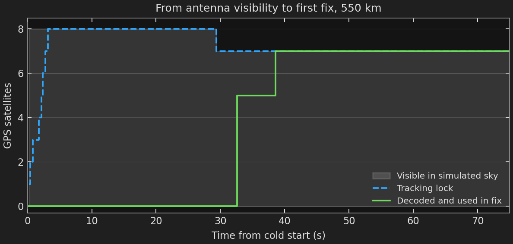

# Receiver measurements

## Cold starts from raw I/Q

The simulated sky contains 24 moving GPS satellites. Each 150-second recording starts with an empty receiver. Signals above the 5° antenna mask are summed, mixed with noise and quantized to the four-bit ADC format. The replay gets only those samples. It searches PRNs 1–32, tracks up to eight channels, decodes LNAV and solves position, velocity and receiver clock at 5 Hz. In these runs, five to eight satellites contributed to each valid fix.

In this 550 km start the first truth-checked fix came at 32.6 s. A carrier can lock well before its navigation words arrive.

All 12 starts passed. The first of five consecutive truth-checked fixes arrived in 23.8–36.4 s. Across the runs, 95th-percentile 3D errors were 1.16–1.86 m in position and 0.041–0.060 m/s in velocity. All 7,155 eligible epochs after first fix produced a valid solution. These numbers describe an idealized RF source with a known antenna pattern, broadcast clocks and orbits. Flight adds oscillator, antenna, atmosphere and broadcast-model errors. [Per-run values and hashes](measurements/baseline.json) · [Cases and gates](../../tests/scenarios.json)

### Controlled range errors

On the same 550 km start, imposing a 10 TECU mean slant electron content with a ±50% variation per link and a 1 m peak satellite range bias raised the 95th-percentile position error from 1.36 m to 2.80 m. First fix remained at 32.6 s. At L1, each TECU delays the code by 0.162 m and advances the carrier by the same distance. Each satellite's imposed variation follows a 30-minute sinusoid with its own phase. This experiment isolates sensitivity to those inputs. A flight-condition prediction needs measured topside electron content and broadcast orbit/clock residuals. [First-order ionospheric delay](https://gssc.esa.int/navipedia/index.php/Ionospheric_Delay)

The 260-second fault replays also exercised signal loss. The receiver invalidated its fix during the 10-second total outage and recovered 12.6 s after signal returned. With only three visible satellites it stayed invalid and recovered 26.4 s after visibility returned. A software warm reset at 180 s cleared the fix. A fresh truth-checked fix returned 32.6 s after reset. The archived results include clock offsets of ±2 ppm, a 24 dB fade on one signal and the rotating antenna case. [Fault results](measurements/baseline.json)

## Bare Pico Plus 2

The RP2350B ran at 150 MHz from SRAM. A PIO pattern generator supplied a nominal 16.368 MHz clock and a known sequence. The digital capture matched all 163,680 samples. A second check compared four parallel one-bit PIO inputs with the packed four-pin input on the same edges and found zero differences. The clock monitor detected 10 µs interruptions at both high and low levels. These measurements use the unwired Pico.

The live scalar receiver missed 4, 11 and 23 input blocks on the respective 1,000-epoch runs. It dropped lock after the overrun. Its 95th-percentile timing then mostly describes the empty receiver. The plot gives the worst measured time in each run. A separate paced-by-computation test retained all requested locks and matched the native reference on the final epoch at every channel count. Eight channels took 20.91 ms per 1 ms of input in that test. An experimental shared-prefix correlator reduced the eight-channel mean to 8.23 ms. [Firmware and bench commands](../../firmware/README.md)

## Accuracy target

The first conducted acceptance target is 10 m at the 95th percentile in three dimensions over a complete orbit. A longer-term engineering target is about 1 m 3D RMS after convergence. In flight-data studies, a single-frequency receiver combining code and carrier with a dynamics filter reached roughly 0.6–1 m 3D RMS using broadcast ephemerides. The next accuracy experiment would retain carrier-phase arcs, detect cycle slips and measure an orbital filter against independent truth. Pico timing and end-to-end Safran tests remain open. [DLR flight-data study](https://doi.org/10.1007/s10291-007-0080-x) · [Single-frequency SJ-9A study](https://doi.org/10.1007/s10291-016-0586-1) · [Conducted test procedure](conducted.md)

Run `python3 tools/plot_results.py` with Matplotlib to regenerate the figures from the checked-in measurements.
